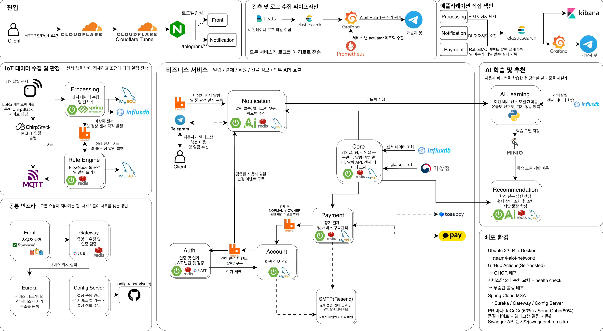
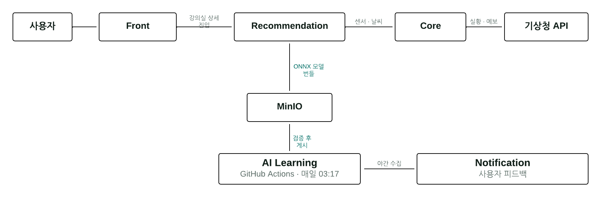
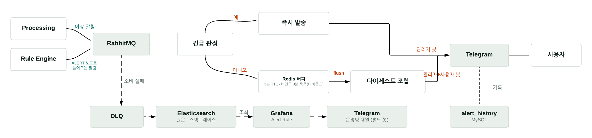
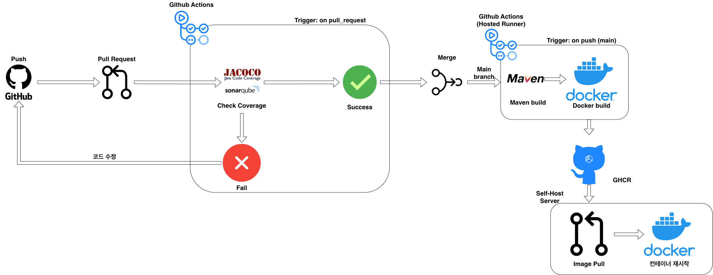

   
   

  <h1>🚨 4iren (4팀)</h1>
  
<b>공간 융합형 데이터 기반 AIoT 지능형 강의실 환경 제어 플랫폼</b>

  
11주간 함께 만들어가는 인공지능 기반 환경 관리 솔루션 프로젝트입니다.

 

  <a href="https://4iren.site">🖥️ 홈페이지</a> &nbsp; | &nbsp; <a href="https://github.com/nhnacademy-aiot3-4iren/4iren-wiki/wiki">📄 Team Wiki</a> &nbsp; | &nbsp; <a href="https://www.erdcloud.com/d/q7kidmecHWe63LEjt">📚 ERD Cloud</a>

  <a href="https://grafana.4iren.site"> Grafana</a> &nbsp; | &nbsp; <a href="https://swagger.4iren.site"> Swagger</a>

> ⚠️ Grafana와 Swagger는 **4iren organization 소속 GitHub 계정으로만 로그인**됩니다.

 

---

## 🚨 왜 4iren인가

> 위험을 가장 먼저 감지하고 경보를 울리는 **사이렌(Siren)** 처럼,
> **4iren**은 교육 공간의 공기질 이상을 가장 먼저 감지해 알리고, 무엇을 해야 할지까지 설명해 주는 AIoT 플랫폼입니다.

### 😮‍💨 이런 문제, 익숙하지 않으신가요?

- 실내 공기질이 나빠져도 **아무도 바로 알아채지 못합니다.**
- 수업이 끝난 강의실의 냉난방기가 **켜진 채로 방치**됩니다.
- 환기를 유지할지 냉방을 유지할지, 매번 **사람이 날씨까지 확인하며 판단**해야 합니다.
- 강의실마다 크기·창문 유무·단열 상태·밀집도가 달라 **일률적인 규칙만으로는 최적화가 불가능**합니다.
- 관리해야 할 강의실이 많아질수록 **담당자 없는 사각지대**가 생깁니다.

### 🎯 서비스 목표

교육 시설에 설치된 IoT 센서 데이터를 수집·관제하고, **규칙 기반 자동화**와 **LLM·ML 기반 지능형 판단**을 결합해 사람이 매번 개입하지 않아도 실내 환경 상태를 파악하고 조치를 안내받을 수 있게 하는
AIoT 플랫폼입니다.

> 센서·MQTT 연동을 마치면 강의실별로 임계치 규칙을 시각적으로 구성할 수 있고, 누적된 사용자 피드백을 야간 배치로 학습해 강의실별 선호 환경값을 보정합니다.

**🏫 타겟 고객** — 여러 강의실·실습실을 운영하며 공기질·에너지 관리를 체계화하고 싶은 교육기관 (대학, 학원, 부트캠프 등)

### 💡 핵심 가치

| 가치                 | 설명                                                                                                      |
|--------------------|---------------------------------------------------------------------------------------------------------|
| ⚡ **비동기 파이프라인**    | 센서 패킷 인입부터 알림 발송까지 비동기 처리 (MQTT → RabbitMQ → 각 서비스). 실시간 스트리밍(SSE) API를 제공하며, 웹 화면은 조회 시점 기준 15분 평균을 표시 |
| 🧩 **자동화의 2단계 구조** | 사람이 정한 명시적 규칙(임계치 기반 플로우 엔진)과, 상황을 해석해 자연어로 설명·추천하는 LLM 판단을 함께 제공                                       |
| 🌦️ **맥락 있는 판단**   | 실내 센서 데이터뿐 아니라 기상청 실황·예보까지 결합해 "왜 이 조치가 필요한지"를 자연어로 설명                                                  |
| 🧠 **피드백 학습**      | 텔레그램으로 모인 사용자 만족도 피드백을 야간 배치로 학습해, 공통 모델 위에 강의실별 보정값(residual adapter)과 선호 환경 프로필을 갱신                   |

---

## 📅 Project Info

**프로젝트 기간 : 11주 (2026.07.06 ~ 2026.09.22)**

  <ul>
    <li><b>1~2주차:</b> 기획 및 MSA 아키텍처 설계</li>
    <li><b>3~9주차:</b> 기능 구현, 데이터 파이프라인 통합 및 AI 모델 고도화</li>
    <li><b>10~11주차:</b> 통합 테스트, 시스템 이중화 검증 및 최종 발표</li>
  </ul>

--- 

  <h3> 🔥 Team 4 Members (9명)</h3>

  <table>
    <tr>
      <td align="center"><a href="https://github.com/pp0ng"> 김태희</a> Rule Engine</td>
      <td align="center"><a href="https://github.com/shinjunsik"> 신준식</a> Infra / CI·CD</td>
      <td align="center"><a href="https://github.com/yooncy123"> 윤채영</a> Recommendation / Core</td>
      <td align="center"><a href="https://github.com/Uoo-uu"> 유대연</a> Recommendation / Core</td>
      <td align="center"><a href="https://github.com/jeongmin26"> 이정민</a> Auth / Account</td>
    </tr>
  </table>

  <table>
    <tr>
      <td align="center"><a href="https://github.com/onyune"> 전유진</a> AI Predict / Notification</td>
      <td align="center"><a href="https://github.com/likeironbasic"> 최이건</a> AI Learning</td>
      <td align="center"><a href="https://github.com/hjiwon203"> 황지원</a> Rule Engine</td>
      <td align="center"><a href="https://github.com/JAENA216"> 전재나</a> Front / Auth</td>
    </tr>
  </table>

 

---

## 🛠️ Tech Stack

  <h3>Backend & Frameworks</h3>
  
  
  
  
  
  

<h3>Databases & Message Brokers</h3>

<h3>Infrastructure & Tools</h3>

<h3>Frontend & AI</h3>

---

## 📂 Repositories

<h3>🌐 Gateway & Infra</h3>

<table align="center">
  <tr><th align="center">Repository</th><th align="center">설명</th></tr>
  <tr><td align="center"><a href="https://github.com/nhnacademy-aiot3-4iren/4iren-gateway">4iren-gateway</a></td><td align="center">게이트웨이</td></tr>
  <tr><td align="center"><a href="https://github.com/nhnacademy-aiot3-4iren/4iren-eureka">4iren-eureka</a></td><td align="center">유레카</td></tr>
</table>

<h3>🖥️ Front</h3>

<table align="center">
  <tr><th align="center">Repository</th><th align="center">설명</th></tr>
  <tr><td align="center"><a href="https://github.com/nhnacademy-aiot3-4iren/4iren-front-server">4iren-front</a></td><td align="center">프론트</td></tr>
</table>

<h3>⚙️ Core Services</h3>

<table align="center">
  <tr>
    <th align="center">Repository</th>
    <th align="center">설명</th>
    <th>세부기능</th>
  </tr>
  <tr><td align="center"><a href="https://github.com/nhnacademy-aiot3-4iren/4iren-rule-engine">4iren-rule-engine</a></td><td align="center">룰 엔진</td><td><a href="https://github.com/nhnacademy-aiot3-4iren/4iren-wiki/wiki/Rule%E2%80%90engine-%E2%80%90%EC%84%B8%EB%B6%80%EA%B8%B0%EB%8A%A5">Rule Engine 세부기능</a></td></tr>
  <tr><td align="center"><a href="https://github.com/nhnacademy-aiot3-4iren/4iren-processing">4iren-processing</a></td><td align="center">데이터 전처리</td><td><a href="https://github.com/nhnacademy-aiot3-4iren/4iren-wiki/wiki/%EC%84%BC%EC%84%9C-%EB%8D%B0%EC%9D%B4%ED%84%B0-%EC%88%98%EC%A7%91-%EB%B0%8F-%EC%A0%84%EC%B2%98%EB%A6%AC-%EC%84%9C%EB%B9%84%EC%8A%A4-(Processing-Service)">Processing 세부기능</a></td></tr>
  <tr><td align="center"><a href="https://github.com/nhnacademy-aiot3-4iren/4iren-core-api">4iren-core</a></td><td align="center">핵심 비즈니스</td><td><a href="https://github.com/nhnacademy-aiot3-4iren/4iren-wiki/wiki/Core-%E2%80%90-%EC%84%B8%EB%B6%80%EA%B8%B0%EB%8A%A5">Core 세부기능</a></td></tr>
  <tr><td align="center"><a href="https://github.com/nhnacademy-aiot3-4iren/4iren-recommendation-api">4iren-recommendation</a></td><td align="center">LLM 처리</td><td><a href="https://github.com/nhnacademy-aiot3-4iren/4iren-wiki/wiki/Recommendation-%E2%80%90-%EC%84%B8%EB%B6%80%EA%B8%B0%EB%8A%A5">Recommendation 세부기능</a></td></tr>
</table>

<h3>🔐 Auth & Account</h3>

<table align="center">
  <tr><th align="center">Repository</th><th align="center">설명</th><th>세부기능</th></tr>
  <tr><td align="center"><a href="https://github.com/nhnacademy-aiot3-4iren/4iren-auth-api">4iren-auth</a></td><td align="center">인증/인가</td><td><a href="https://github.com/nhnacademy-aiot3-4iren/4iren-wiki/wiki/Auth-%E2%80%90-%EC%84%B8%EB%B6%80%EA%B8%B0%EB%8A%A5">Auth 세부기능</a></td></tr>
  <tr><td align="center"><a href="https://github.com/nhnacademy-aiot3-4iren/4iren-account-api">4iren-account</a></td><td align="center">유저 CRUD</td><td><a href="https://github.com/nhnacademy-aiot3-4iren/4iren-wiki/wiki/Account-%E2%80%90-%EC%84%B8%EB%B6%80%EA%B8%B0%EB%8A%A5">Account 세부기능</a></td></tr>
</table>

<h3>💳 결제(Payment)</h3>

<table align="center">
  <tr><th align="center">Repository</th><th align="center">설명</th><th>세부기능</th></tr>
  <tr><td align="center"><a href="https://github.com/nhnacademy-aiot3-4iren/4iren-payment-api">4iren-payment</a></td><td align="center">구독 결제 (Toss·Kakao Pay)</td><td><a href="https://github.com/nhnacademy-aiot3-4iren/4iren-wiki/wiki/Payment-%E2%80%90-%EC%84%B8%EB%B6%80%EA%B8%B0%EB%8A%A5">Payment 세부기능</a></td></tr>
</table>

<h3>🔔 Notification</h3>

<table align="center">
  <tr><th align="center">Repository</th><th align="center">설명</th><th>세부기능</th></tr>
  <tr><td align="center"><a href="https://github.com/nhnacademy-aiot3-4iren/4iren-notification-service">4iren-notification</a></td><td align="center">알림(텔레그램) 처리</td><td><a href="https://github.com/nhnacademy-aiot3-4iren/4iren-wiki/wiki/Notification-API-%E2%80%90-%EC%84%B8%EB%B6%80%EA%B8%B0%EB%8A%A5">Notification 세부기능</a></td></tr>
</table>

<h3>🤖 AI</h3>

<table align="center">
  <tr><th align="center">Repository</th><th align="center">설명</th><th>세부기능</th></tr>
  <tr><td align="center"><a href="https://github.com/nhnacademy-aiot3-4iren/4iren-machine-learning">4iren-AI-Learning</a></td><td align="center">피드백 기반 야간 모델 갱신 파이프라인</td><td><a href="https://github.com/nhnacademy-aiot3-4iren/4iren-wiki/wiki/AI%E2%80%90Learning-%E2%80%90-%EC%84%B8%EB%B6%80%EA%B8%B0%EB%8A%A5">AI Learning 세부기능</a></td></tr>
</table>

 

---

## Architecture Overview

   
    

### 머신러닝 파이프라인

강의실 상세 화면 진입 시 만들어지는 웰컴 브리핑이, 매일 새벽 도는 학습 배치와 어떻게 이어지는지는 아래 흐름을 참고하세요. 자세한
내용은 [AI Learning 세부기능](https://github.com/nhnacademy-aiot3-4iren/4iren-wiki/wiki/AI%E2%80%90Learning-%E2%80%90-%EC%84%B8%EB%B6%80%EA%B8%B0%EB%8A%A5)
에 있습니다.

   
    

### 알림 파이프라인

Processing·Rule Engine이 발행한 이벤트가 텔레그램으로 발송되기까지의 흐름입니다. 긴급/비긴급 경로가 나뉘고, 실패한 메시지는 별도로 Grafana를 통해 운영팀에게 알림이 갑니다. 자세한
내용은 [Notification API 세부기능](https://github.com/nhnacademy-aiot3-4iren/4iren-wiki/wiki/Notification-API-%E2%80%90-%EC%84%B8%EB%B6%80%EA%B8%B0%EB%8A%A5)
에 있습니다.

   
    

### CI/CD 파이프라인

개발자의 코드 푸시(Push)부터 운영 서버에 무중단으로 배포되기까지의 전체 CI/CD 자동화 흐름입니다. PR 단계에서 SonarQube와 JaCoCo를 통해 코드 품질을 엄격하게 검증하며, 메인 브랜치 병합 시
헬스체크 기반의 롤링 업데이트로 서비스 중단 없이 안전하게 배포됩니다. 파이프라인의 모든 성공/실패 결과는 Telegram 봇을 통해 즉각적으로 팀에 공유됩니다.

   
    

---

## 📊 모니터링

서비스 로그, 알림 발송 실패(DLQ) 현황은 Elasticsearch 기반으로, JVM·인프라 지표는 Prometheus로 수집해 Grafana로 시각화하여 확인할 수 있고, 전체 서비스 API 명세는 Swagger로 통합 제공합니다. 대시보드 화면과 상세 설명은 [운영/모니터링 가이드](https://github.com/nhnacademy-aiot3-4iren/4iren-wiki/wiki/운영-모니터링-가이드)에서 확인하세요.

---

## 요구사항

기능 요구사항

| 영역       | 요구사항                                                                     |
|----------|--------------------------------------------------------------------------|
| 센서 수집    | 건물별 MQTT 브로커 동적 등록, LoRaWAN(ChirpStack) 업링크 수집 및 InfluxDB 적재             |
| 센서 관제    | 강의실별 센서 지표 조회 — 최신값 / 최근 15분 평균 / 임의 구간 시계열                              |
| 센서 관제    | 센서 지표 실시간 스트리밍 API 제공 (SSE, `Last-Event-ID` 기반 재생)                       |
| 날씨 연동    | 기상청 초단기 실황·예보 조회, 강의실 위치 기반 지역 날씨 및 시간별 과거 날씨 재구성                        |
| 웰컴 브리핑   | 강의실 상세 화면 진입 시, 밤새 축적된 환경 데이터 + 당일 날씨 + ML 추천을 종합한 브리핑 생성 (오전 10시 이전 한정) |
| 일일 요약    | 강의실별 실내 센서 데이터와 외부 날씨를 비교한 하루 요약 리포트 생성                                  |
| 브리핑 정책   | 팀·강의실별 브리핑 조건(강수확률·풍속·습도 임계값) 설정                                         |
| 피드백 학습   | 텔레그램 피드백을 야간 배치로 학습해 강의실별 보정값·선호 환경 프로필 갱신 후 모델 번들 배포                    |
| 기기 운전 추천 | 학습된 ONNX 모델로 냉난방기 가동 시간대·환기 시점을 추천해 브리핑 근거로 제공                           |
| 룰 엔진     | 강의실별 시각적 플로우(조건 노드 → 분기 → 알림 노드) 구성 및 활성/비활성 관리                          |
| 룰 엔진     | 요일·시간대 스케줄로 플로우 동작 구간 제한, 센서 구성에 맞는 템플릿 추천                               |
| 알림       | 관리자 대상 임계치 이탈 알림 (관리자 전용 봇, 발송 전용)                                       |
| 알림       | 긴급 알림 즉시 발송 / 비긴급 알림 3분 디바운스 묶음 발송                                       |
| 자연어 질의응답 | "지금 환기해도 될까?" 등 도구 호출 기반 자연어 답변 (웹 챗봇 + 텔레그램 봇)                          |
| 피드백 수집   | 자유 텍스트에서 온도·습도·공기질 3축 감정 점수 추출, 환경 스냅샷과 결합해 학습 데이터로 적재                   |
| 이력 조회    | 알림 발송 이력 조회(강의실·봇 종류·알림 유형·기간 필터), 기기 동작 이력 조회                           |
| 조직 관리    | 팀 / 건물 / 강의실 / 기기 / 센서 CRUD, 초대 코드 기반 팀 가입                               |
| 조직 관리    | 강의실 구독(셀프 등록) 및 구독별 알림 수신 여부 설정                                          |
| 조직 관리    | 역할(OWNER / ADMIN / NORMAL)별 접근 권한 차등                                     |
| 계정       | 로그인, JWT 기반 인증/인가, 비밀번호 초기화 메일 발송                                        |
| 결제       | 팀 Owner 등급 월간·연간 구독, 토스페이·카카오페이 빌링키 자동결제, 구독 취소                          |

비기능 요구사항

| 구분         | 요구사항                                                                                                                                                 |
|------------|------------------------------------------------------------------------------------------------------------------------------------------------------|
| 실시간성       | 텔레그램 웹훅 수신은 즉시 200 응답 후 RabbitMQ로 비동기 처리 (텔레그램 재전송 방지)                                                                                               |
| 장애 격리      | 알림 서비스는 Recommendation/Core 호출에 Resilience4j 서킷브레이커·폴백 적용, LLM 장애 시 안내 문구로 대체 응답                                                                     |
| 장애 격리      | 브리핑 생성 실패 시 강의실 상세 화면은 브리핑 영역 없이 정상 렌더링                                                                                                              |
| 서비스 독립성    | 서비스별 스키마 소유권 분리(타 서비스 소유 테이블 직접 접근·JOIN 금지, RabbitMQ 이벤트로만 동기화) — 단, prod MySQL은 물리 인스턴스·스키마(`aiot03_team4`)를 공유하며 Flyway 이력 테이블명으로만 서비스별 마이그레이션을 분리 |
| 확장성        | 센서·강의실 추가 시 파이프라인 코드 변경 없이 수집·검증·알림까지 동작 (단, ML 학습 대상 공간은 현재 코드에 정의된 목록에 한정)                                                                         |
| 성능         | 센서 요약 조회는 Caffeine(L1) + Redis(L2) 계층 캐시, 브리핑·일일 요약·날씨는 Redis TTL 캐시                                                                                 |
| 신뢰성        | 이상치 알림은 1시간 창 누적 횟수 기준 + 2시간 쿨다운, 룰 알림은 Redis 락 기반 중복 발송 차단                                                                                          |
| 신뢰성        | 처리 실패 메시지는 DLQ로 격리 후 Elasticsearch에 원문·스택트레이스 보관                                                                                                     |
| 보안         | 텔레그램 봇 차단 시 알림 대상에서 자동 제외, 구독자 조회 시 비활성 계정 필터링                                                                                                       |
| 보안         | 게이트웨이가 주입한 `X-USER-ID`/`X-USER-ROLE` 헤더 기반 역할 검증, 본인 리소스만 조회·수정 허용                                                                                   |
| 데이터 무결성    | 엔티티 간 참조를 명시적 FK 제약으로 선언 (`@JoinColumn(foreignKey=...)`)                                                                                             |
| 데이터 일관성    | 이벤트 기반 동기화 데이터는 최종적 일관성 전제, 역할 변경·관리자 생성 이벤트는 DLQ 재처리 경로 보유                                                                                          |
| 오버엔지니어링 회피 | 실제 필요성이 확인되기 전까지 불필요한 스키마 확장·과도한 동기화 인프라 도입 지양                                                                                                       |

---

## 제공 기능

- **센서 수집·관제**: MQTT 브로커 동적 등록, 최신값/15분 평균/구간 시계열 조회, SSE 실시간 스트리밍 API
- **지능형 웰컴 브리핑**: 강의실 상세 진입 시 밤새 환경 데이터·당일 날씨·ML 추천을 종합한 브리핑 생성 (오전 10시 이전)
- **일일 환경 요약**: 실내 센서와 외부 날씨를 비교한 하루 요약 리포트
- **피드백 학습 파이프라인**: 텔레그램 피드백을 야간 배치로 학습해 강의실별 보정값·선호 프로필 갱신 후 모델 번들 배포
- **기기 운전 추천**: 학습된 ONNX 모델 기반 냉난방기 가동 시간대·환기 시점 추천
- **룰 기반 자동화**: 강의실별 시각적 플로우 구성, 요일·시간대 스케줄, 센서 구성 기반 템플릿 추천
- **텔레그램 알림**: 관리자용(발송 전용)/사용자용(양방향 에이전트) 이원화 봇, 긴급 즉시 발송 + 비긴급 3분 묶음 발송
- **자연어 질의응답 및 피드백 루프**: 도구 호출 기반 답변 + 3축 감정 점수 피드백 수집
- **이력 조회**: 알림 발송 이력(다중 필터), 기기 동작 이력
- **조직 및 접근 권한 관리**: 팀/건물/강의실/기기/센서 CRUD, 초대 코드 가입, 역할 기반 권한
- **구독 결제**: 팀 Owner 등급 월간/연간 구독, 토스페이·카카오페이 빌링키 등록 및 자동결제

